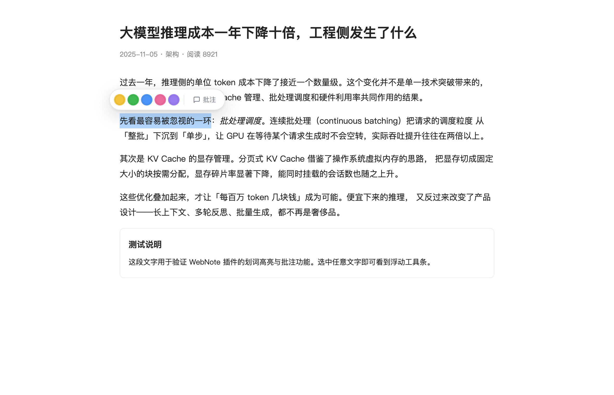
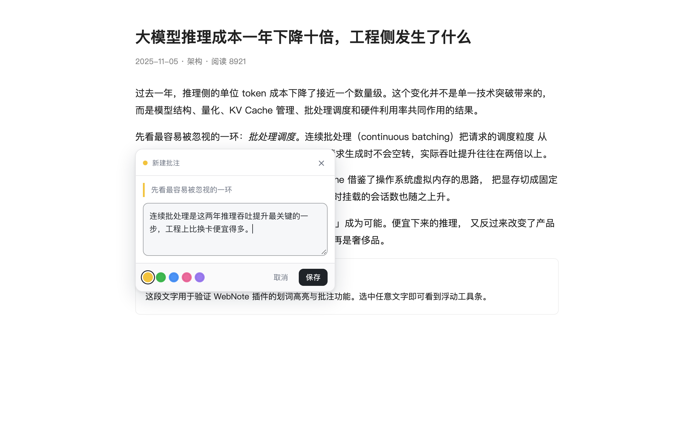
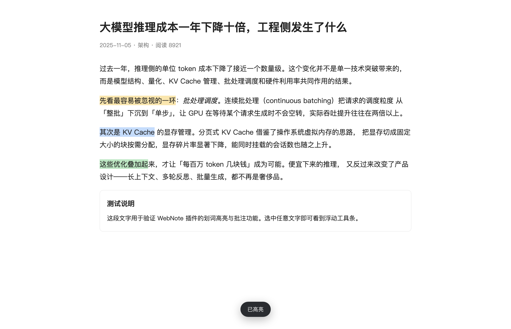
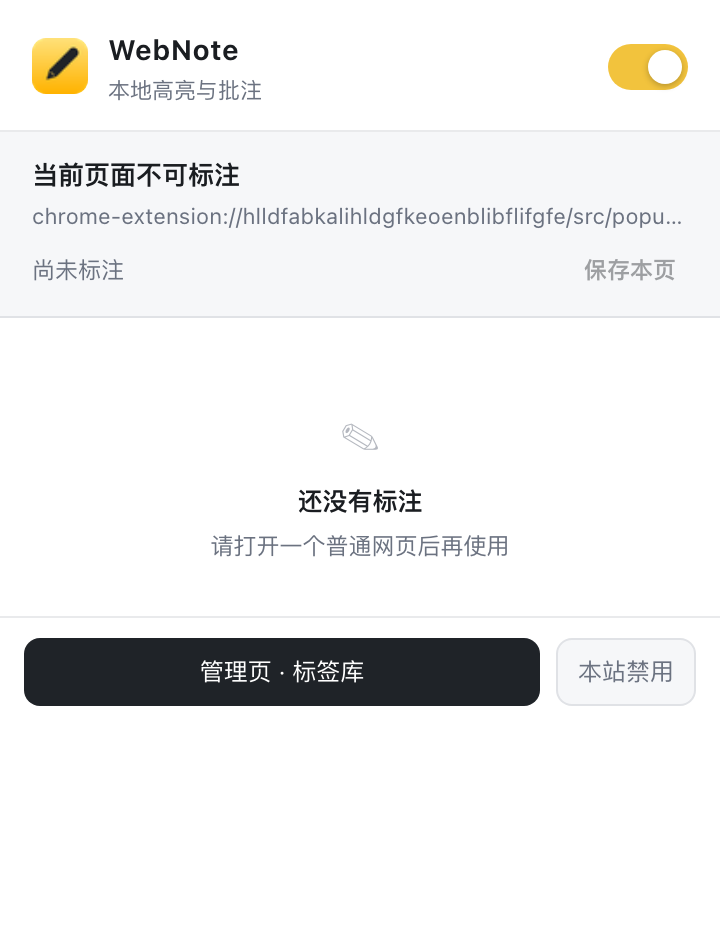
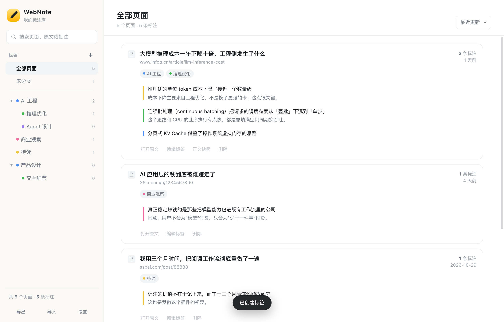
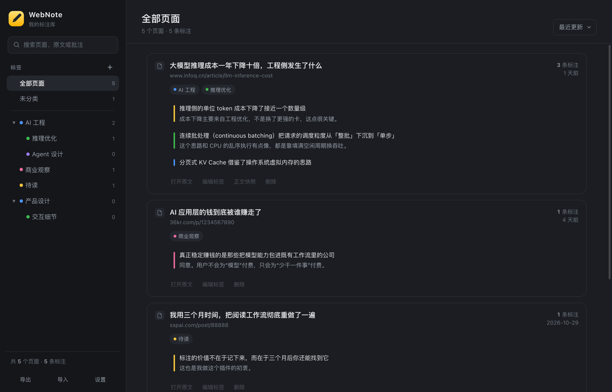

# WebNote

在任意网页上划词高亮、写私人批注，并用标签把读过的东西整理成自己的库。
**所有数据只存在你本机的浏览器里**，不需要登录、不上传、不联网。



---

## 它是什么，不是什么

**它是个单机阅读批注本。** 你在网上读到一段话，划一下、写两句，回头能按标签找回来。
整个插件约 145 KB 源码，没有任何外部依赖，也不发起任何网络请求——断网照常工作。

**它不是网页存档工具。** 标注是**锚在活着的原网页上**的：原网页打不开、或者改版改得太狠，那个位置就没了。
保存时抓的正文快照只是纯文本——能读，但读不到格式，也不能在上面重新高亮。
换句话说是「书还在时的便利贴」，不是「把书复印一份」。

**它也不是笔记社区。** 没有账号、没有服务器、没有同步、没有协作，所以也就不需要处理
评论审核、权限分享、内容下架那一整套东西。功能边界窄，正是它保持轻量的原因——

它只解决「自己看书、自己做点笔记」，不解决「把笔记给别人看」。
真需要后者，管理页导出 JSON 就够了。

---

## 自己安装（30 秒）

1. 打开 `chrome://extensions/`（Edge 是 `edge://extensions/`）
2. 右上角打开 **开发者模式**
3. 点 **加载已解压的扩展程序**，选中本文件夹（`webnote/`）
4. 建议点浏览器右上角的拼图图标，把「WebNote」固定到工具栏

> 装好后第一次会自动打开管理页。已经开着的网页刷新一次即可生效。

---

## 分享给别人

### 一个容易误会的地方

插件是本地工具，**分享插件不等于分享笔记**。每个人的标注都存在自己电脑的 `chrome.storage.local` 里，互相看不到。想交换笔记只能各自「导出 JSON」再「导入」。

---

## 怎么用

### 在网页上标注

1. 选中一段文字 → 浮出小工具条
2. 点颜色圆点 = 直接高亮；点「批注」= 写想法
3. 点已有的高亮 = 重新打开这条批注，可以改颜色、改文字、删除



同一页面可以叠多种颜色：



### 三个入口，按习惯挑

| 方式 | 操作 |
| --- | --- |
| 划词 | 选中文字后点浮出的工具条 |
| 右键菜单 | 选中文字 → 右键 → 「标注选中文字」→ 选颜色或写批注 |
| 快捷键 | `Alt+Shift+H` 高亮，`Alt+Shift+M` 写批注（可在 `chrome://extensions/shortcuts` 改） |

右键页面空白处还有「保存本页到 WebNote」，会连同正文快照一起存下来。

### 一键开关

点工具栏图标，弹窗右上角就是总开关（和沉浸式翻译一样的位置）。
底部的「本站禁用」可以让某个站点安静下来，比如你不想在邮箱里误触。



---

## 管理页：按标签层级整理

点弹窗里的「管理页 · 标签库」，或者右键页面选「打开 WebNote 管理页」。



- **左侧标签树**：支持无限层级，点 `＋` 建子标签，`✎` 改名/改色/换父级，`×` 删除（只删分类，不删页面）
- **右侧页面卡片**：显示标题、来源、标注数；展开可以看到每条标注的原文与批注，点一下直接跳回原网页并定位
- **搜索**：同时搜页面标题、网址、原文、批注内容
- **排序**：最近更新 / 最近保存 / 标注最多 / 按标题

深色模式跟随系统：



### 正文快照

保存页面时会顺带存一份纯文本正文。哪怕原网页删了、改版了，你仍然能在管理页点「正文快照」回看当时的文字。
不想要的话可以在「设置」里关掉。

---

## 数据在哪、怎么备份

- 存储位置：浏览器的 `chrome.storage.local`，属于扩展私有空间，其它网站读不到
- 备份：管理页左下角 **导出**，得到一个 JSON 文件（含页面、标注、标签、快照）
- 恢复：**导入** 会做**合并**而不是覆盖，重复导入不会产生重复标注
- 换电脑：导出 JSON → 在新机器导入即可

> 没有服务器也就没有云端备份。清理浏览器数据或卸载扩展会一并删除笔记，建议隔一段时间手动导出一次。

---

## 一些实现上的取舍

- **高亮不改 DOM**：用的是 CSS Custom Highlight API（Chrome 111+），不给页面插 `<mark>`。
  所以不会触发站点的 MutationObserver，也不会打乱 React/Vue 的渲染。
- **标注靠四层定位**：记录字符偏移量 + 原文 + 前后文。页面结构变了，会依次尝试
  「原偏移量 → 含上下文的匹配 → 全文匹配（取最近的一处）→ 忽略空白的宽松匹配」，
  所以插入广告、懒加载内容之后标注通常还能找回来。
- **UI 隔离**：页面上所有界面都活在 Shadow DOM 里，宿主页面的 CSS 影响不到它，反之亦然。
- **写入串行化**：所有写操作都交给后台 service worker 排队执行，多个标签页同时标注不会互相覆盖。

---

## 已知限制

- 只支持 `http://` 和 `https://` 页面；`chrome://`、扩展商店、PDF 阅读器里不生效
- 只处理顶层文档，`iframe` 里的正文抓不到
- 同一条文字如果在一篇文章里出现很多次，且原位置完全变了，可能定位到最近的那一处
- 原网页打不开或大改后，标注就找不到落点，只剩管理页里的「正文快照」可读（纯文本，不含格式，不能重新高亮）
- 需要 Chrome / Edge 111 及以上

---

## 目录结构

```
webnote/
├── manifest.json           # MV3 清单
├── PRIVACY.md              # 隐私政策模板（上架商店时用）
├── assets/icons/           # 图标（16/32/48/128）
├── src/
│   ├── background.js       # 消息路由、右键菜单、快捷键、写入队列
│   ├── shared/
│   │   ├── model.js        # 数据模型与全部 reducer（纯函数，可单测）
│   │   └── store.js        # 存储读写、消息通道、小工具
│   ├── content/
│   │   ├── anchor.js       # 文本锚定算法（偏移量 + 上下文四级定位）
│   │   ├── highlight.js    # CSS Highlight API 渲染与命中检测
│   │   ├── ui.js           # 划词工具条、批注卡片（Shadow DOM）
│   │   ├── content.js      # 页面侧主控
│   │   └── content.css     # ::highlight() 配色
│   ├── popup/              # 工具栏弹窗
│   └── dashboard/          # 管理页
├── store-assets/           # 上架商店用的截图与图块（含提交清单）
├── tools/
│   ├── make_icons.py       # 图标生成脚本
│   └── promo/              # 商店素材生成脚本
└── tests/                  # 测试与截图（不影响插件运行）
```

## 测试

```bash
node tests/model-test.mjs   # 数据层单元测试（52 项）
node tests/e2e.mjs          # 真实 Chrome 端到端（31 项，需本机装有 Chrome）
```

`tests/anchor-test.html` 可以直接用浏览器打开，跑锚定算法的 20 项断言。

改图标或重拍商店素材：

```bash
python3 tools/make_icons.py                                  # 需要 Pillow + numpy
node tools/promo/capture.mjs && python3 tools/promo/build_assets.py   # 需要 Chrome + Pillow
```
